<!-- Pixel art in assets/ is generated by scripts/build.py. The stats card and contribution snake are
     redrawn every day by .github/workflows/pixel-profile.yml and published to the `output` branch. -->

  

  
  &nbsp;&nbsp;
  

  

  <a href="https://github.com/yaksh1010/NotiBar"></a>
  <a href="https://github.com/yaksh1010/BeatBar">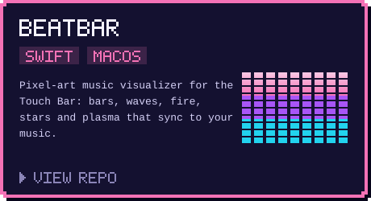</a>
  <a href="https://github.com/yaksh1010/DisplayDial">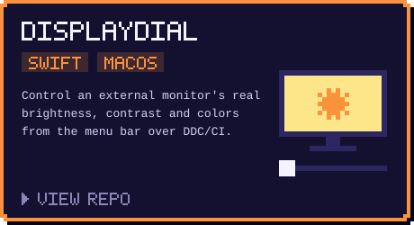</a>

  <b>⬇️ Download:</b>
  <a href="https://github.com/yaksh1010/NotiBar/releases/latest/download/NotiBar.dmg">NotiBar</a> ·
  <a href="https://github.com/yaksh1010/BeatBar/releases/latest/download/BeatBar.dmg">BeatBar</a> ·
  <a href="https://github.com/yaksh1010/DisplayDial/releases/latest/download/DisplayDial.dmg">DisplayDial</a>

  <a href="https://github.com/yaksh1010/TaskMaster"></a>
  <a href="https://github.com/yaksh1010/ARFit"></a>
  <a href="https://github.com/yaksh1010/CampusCrave"></a>
  <a href="https://github.com/yaksh1010/StuTrack-Portfolio">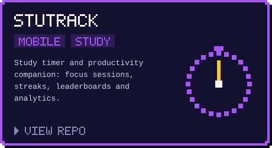</a>
  <a href="https://github.com/yaksh1010/SmartTask-Portfolio"></a>
  <a href="https://github.com/yaksh1010/WorkHive-Portfolio">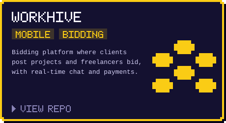</a>

  <b>More:</b>
  <a href="https://github.com/yaksh1010/Scan2Send-Portfolio">Scan2Send</a> ·
  <a href="https://github.com/yaksh1010/GreenGains-Portfolio">GreenGains</a> ·
  <a href="https://github.com/yaksh1010/ZoomOut">ZoomOut</a> ·
  <a href="https://github.com/yaksh1010/Plannify">Plannify</a> ·
  <a href="https://github.com/yaksh1010/Face-Mask-Detection">Face Mask Detection</a>

  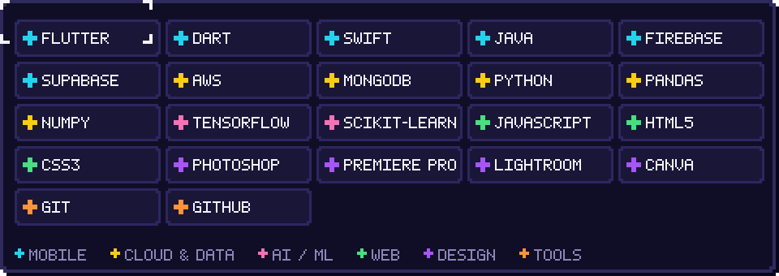

  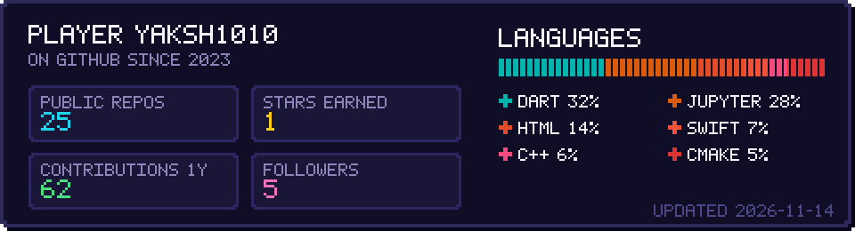

  <picture>
    <source media="(prefers-color-scheme: dark)" srcset="https://raw.githubusercontent.com/yaksh1010/yaksh1010/output/snake-dark.svg">
    <source media="(prefers-color-scheme: light)" srcset="https://raw.githubusercontent.com/yaksh1010/yaksh1010/output/snake-light.svg">
    
  </picture>

  

  

